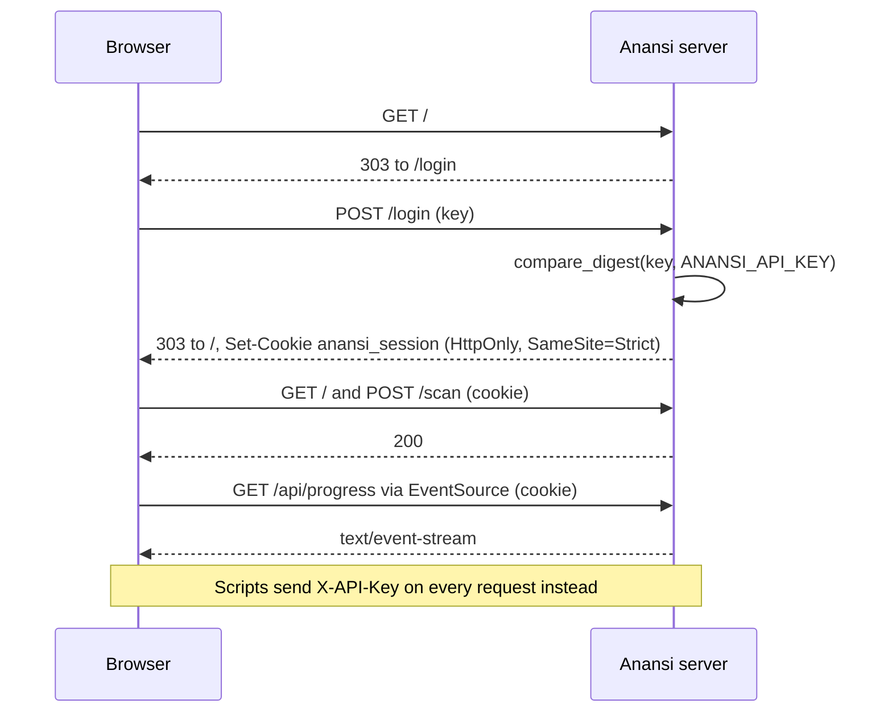

# ADR-0001: Require a session-backed API key for every dashboard and API route

## Status

Accepted

## Date

2026-11-17

## Context

The web dashboard (`web/app.py`) starts nmap scans and, today, Metasploit runs on the machine it runs on. Access control has three gaps:

- **Optional key.** `X-API-Key` is checked only when `ANANSI_API_KEY` is set. Without it, anyone who can reach the server can start scans.
- **Uncovered routes.** `/` (latest results and scan history) and `/api/progress` never check the key, even when one is set.
- **No cross-site protection.** `/scan` is a plain `POST` with query parameters. Any web page the operator visits can send it to `http://127.0.0.1:8000` (cross-site request forgery). A DNS-rebinding page can also read the responses.

The dashboard itself cannot authenticate today. Browser navigation to `/` and the `EventSource` used for `/api/progress` cannot send custom headers, and the dashboard script never sends `X-API-Key`. Setting a key therefore breaks the "Launch Scan" button.

Two kinds of client use the server:

- **The browser dashboard:** server-rendered pages plus a live progress stream.
- **Scripts and `curl`:** they already send `X-API-Key`.

Since commit `d55c61b`, the server refuses to listen on a non-loopback address without `ANANSI_API_KEY`. Loopback use is still unauthenticated.

## Decision Drivers

- Secure by default. A user who sets nothing must not get an API that any web page can drive.
- Every route that reveals or changes state is covered. No allow-list of "safe" routes to drift out of date.
- Keep the server-rendered dashboard and the SSE progress stream working without a frontend rewrite.
- Keep the key out of reach of page JavaScript and out of URLs, history and logs.
- Keep scripted access (`X-API-Key`) working unchanged.
- KISS: one authentication mode, not one per deployment.

## Options Considered

### Option 1: Header-only API key; the dashboard becomes a JavaScript client

The page asks for the key, keeps it in `localStorage` and sends `X-API-Key` on every call. Pages are rendered client-side, and the progress stream moves from `EventSource` to `fetch` with a streamed body.

- **Good:** one credential mechanism. Custom headers force a CORS preflight, so cross-site requests and DNS rebinding are blocked by construction.
- **Bad:** any script running in the page can read the key (the page loads a third-party script today; see ADR-0002). It also means rewriting the server-rendered dashboard as a client app.

### Option 2: Always require a key; browsers exchange it for an HttpOnly session cookie

Every route except the login page requires either `X-API-Key` or a session cookie. The browser's login form posts the key once. The server checks it in constant time and returns a random session token in an `HttpOnly`, `SameSite=Strict` cookie. If `ANANSI_API_KEY` is unset and the server is on loopback, a random key is generated at startup and printed to the terminal, the way Jupyter prints its token.

- **Good:** server-rendered pages and `EventSource` keep working, because browsers send cookies automatically. Page JavaScript cannot read the key or the session. `SameSite=Strict` stops cross-site pages from sending the cookie. A DNS-rebinding page runs on the attacker's hostname, so it never has the cookie and gets 401. There is one mode for localhost and Docker alike. Scripts are unchanged.
- **Bad:** adds a login page, a logout route and an in-memory session store, so sessions end on restart and the user logs in again. The `Secure` cookie flag can only be set when served over HTTPS.

### Option 3: Keep keyless localhost mode and add request-origin checks

Keep auth optional on loopback, and block cross-site use with a `Host` allow-list (against DNS rebinding) and an `Origin` check on state-changing requests. Add the cookie flow only when a key is set.

- **Good:** no login step for local use.
- **Bad:** two security modes to build, test and reason about. Any local process or other OS user can still drive the API. The protection depends on browser headers being present and correct, not on a credential.

## Decision

We will use **Option 2**. It is the only option that is secure by default, covers every route with one rule, and keeps the existing server-rendered dashboard and SSE stream. Option 1 trades one problem (cookie handling) for a worse one: the key becomes readable from page JavaScript. Option 3 keeps an unauthenticated mode, which is what caused these gaps.

The rules:

1. **Authentication on every route.** Every route requires a valid `X-API-Key` header or session cookie, except `GET /login`, `POST /login` and `/static`. Unauthenticated browser `GET` requests for HTML are redirected to `/login` with status 303. Everything else gets 401.
2. **Login.** `POST /login` checks the submitted key with `secrets.compare_digest`. On success it issues `secrets.token_urlsafe(32)` as cookie `anansi_session` with `HttpOnly`, `SameSite=Strict` and `Path=/`, plus `Secure` when the request came over HTTPS. Sessions expire after 12 hours. `POST /logout` deletes the session.
3. **Session store.** Sessions live in an in-memory map from token to expiry, behind a small port, so tests can inject a clock.
4. **Key source.** If `ANANSI_API_KEY` is unset on a loopback address, the server generates a `secrets.token_urlsafe(32)` key and prints it to the terminal (stdout, not the log file). The non-loopback rule from commit `d55c61b` stays: an explicit key is required, because a generated key printed into container logs would be collected by log shippers.
5. **Key strength.** A configured `ANANSI_API_KEY` shorter than 16 characters is rejected at startup.
6. **UI elements.** The login page uses a native HTML `<form>`, `<label>`, `<input type="password">` and `<button>`. It has no custom widgets, so no headless component library is needed. Tests cover the labelled field, the submit-on-Enter keyboard path and the accessible error message.

## Consequences

### Positive

- No route reveals or changes state without a credential, in any deployment.
- Cross-site request forgery and DNS rebinding against the local dashboard are blocked by the credential itself, not by browser-header checks.
- "Launch Scan" works with a key set, closing roadmap item S2.
- Scripted access is unchanged.

### Negative / Trade-offs

- Local use gains a login step: the operator copies the printed key once per server start, unless they set `ANANSI_API_KEY`.
- Sessions are lost on restart.
- Tests that call the API must authenticate. The existing tests that clear the environment to skip auth need a fixture key.

### Risks

- `SameSite=Strict` relies on browser support. All current browsers support it; very old browsers would fall back to no cross-site protection.
- Over plain HTTP on a network, the cookie and key travel unencrypted. Network deployments should sit behind TLS. The README must say so.
- An in-memory session store does not work across multiple server processes. Today the app runs a single uvicorn worker.

## Links

- Roadmap items S1, S2, S3 (`ROADMAP.md`, Audit Remediation, Phase 2)
- Related: [ADR-0002](0002-serve-dashboard-styles-and-scripts-from-the-app-with-a-strict-csp.md)
- [OWASP Cross-Site Request Forgery Prevention Cheat Sheet](https://cheatsheetseries.owasp.org/cheatsheets/Cross-Site_Request_Forgery_Prevention_Cheat_Sheet.html)
