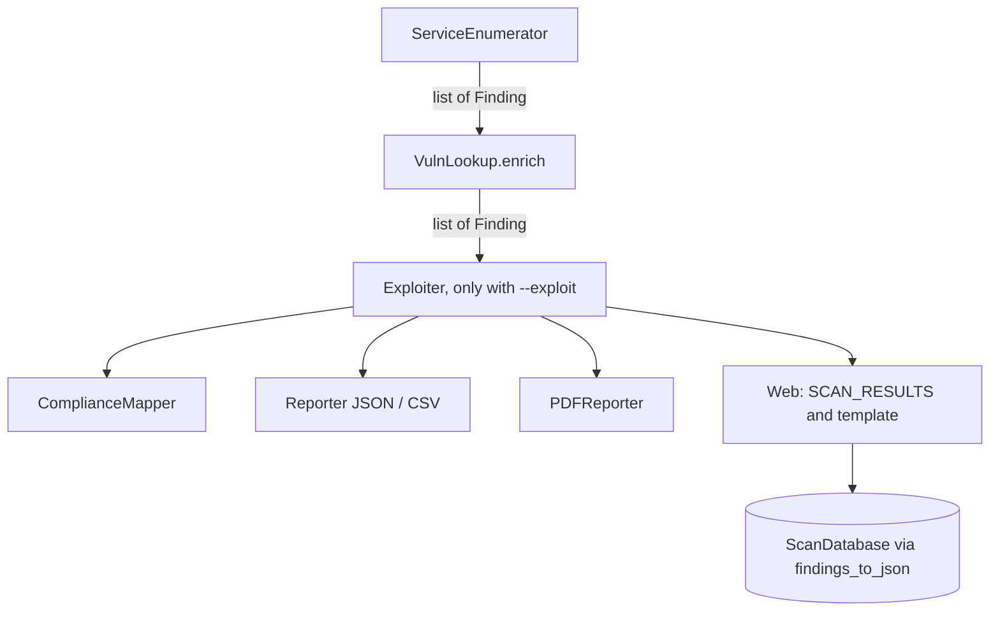

# ADR-0003: Model scan results as typed Finding records

## Status

Accepted

## Date

2026-11-17

## Context

`ServiceEnumerator.enumerate()` returns an untyped `{port: {service, product, version}}` dict. `VulnLookup.enrich()` adds a `cves` list to each entry. The key is the port alone, so in a CIDR scan every host with port 80 overwrites the one before it. Only the last host's services survive (roadmap item C1).

Every stage after enumeration depends on this shape:

| Consumer | How it uses the shape |
|---|---|
| `VulnLookup.enrich` | iterates `.items()`, returns the same shape plus `cves` |
| `Exploiter` | passes it through |
| `Reporter` (JSON and CSV) | dumps it as-is; iterates `.items()` for CSV rows |
| `PDFReporter` | iterates `.items()` |
| `ComplianceMapper` | iterates `.items()` |
| `main.py` | wires the CLI pipeline |
| `web/app.py` | runs the pipeline, keeps `SCAN_RESULTS`, saves it via `ScanDatabase.complete_scan` |
| `web/templates/index.html` | iterates `results.items()` |
| `GET /api/scan/{id}` | returns the stored JSON |

Under the engineering standards, changing this shape is a breaking-contract change, and the type checker, not grep, should find every consumer. The project has no type checker today, and Jinja's attribute lookup falls back to `dict` keys. A careless change could therefore render either shape without complaint.

This is also the first concrete piece of the domain layer planned in roadmap item H2.

## Decision Drivers

- Results from different hosts must never overwrite each other.
- The compiler must find every consumer of the result type. A forgotten caller should fail type-checking, not produce a quietly wrong report.
- Keep the change mechanical and reviewable: one consumer per step, tests green after each.
- Start the domain layer without restructuring the whole project.

## Options Considered

### Option 1: Nested dict `{host: {port: info}}`

Add a host level to the existing dict and update every consumer.

- **Good:** smallest diff; no new tooling.
- **Bad:** still untyped, so only the tests show whether every consumer was updated. Protocol is still not part of the key (TCP 53 and UDP 53 collide). The shape stays implicit, documented only in docstrings.

### Option 2: A typed `Finding` dataclass, checked by mypy

A `Finding` is one service on one host, port and protocol. The enumerator returns `list[Finding]`, and every consumer takes and returns `list[Finding]`. mypy runs in CI and checks the domain module strictly and each migrated consumer with `disallow_untyped_defs`.

- **Good:** host, port and protocol are explicit fields, so nothing collides. Every consumer's signature names the type, so mypy reports any caller still passing a dict. The model becomes the first domain module.
- **Bad:** touches every consumer and the report formats. Adds mypy and type stubs to CI. Each migrated module has to be fully annotated.

## Decision

We will use **Option 2**. Option 1 fixes the overwrite but keeps the exact weakness that let it go unnoticed: a contract nothing checks. Option 2 is more work once, but every later change to the result model gets checked by mypy.

### The model (`domain/findings.py`)

```python
@dataclass(frozen=True)
class Cve:
    id: str
    score: float | None
    severity: str
    description: str

@dataclass(frozen=True)
class Finding:
    host: str
    port: int
    protocol: Literal["tcp", "udp"]
    service: str
    product: str
    version: str
    cves: tuple[Cve, ...] = ()
```

- Records are frozen. Enrichment returns new records with `dataclasses.replace`, so no stage mutates another stage's output.
- `domain/` is a new top-level package with no imports from `modules/`, `web/` or any third-party library. It is the start of the hexagonal domain layer (H2).
- Serialization lives at the edges: a `findings_to_json()` helper gives a list of plain dicts for the JSON report, the database and the API.

### Shape at the boundaries

- **JSON report, stored history and `GET /api/scan/{id}`:** a list of objects with `host`, `port`, `protocol`, `service`, `product`, `version` and `cves`. Previously this was an object keyed by port.
- **CSV report:** gains `Host` and `Protocol` columns.
- **PDF report and dashboard:** group findings by host.

### Type checking

- `mypy.ini` checks `domain`, `modules`, `web` and `main.py`.
- `domain.*` is checked with `strict = True`. Each module that consumes findings is checked with `disallow_untyped_defs = True`, so its signatures must name `Finding`.
- CI installs `mypy`, `types-PyYAML` and `types-requests` and runs mypy as a blocking step.
- Templates are outside mypy's reach. A rendering test passes `Finding` objects and asserts that the host column appears. The template iterates a list, so the old dict shape fails loudly instead of rendering.

### Migration order

Each step keeps the full test suite passing:
1. `domain/findings.py` and mypy config.
2. Enumerator.
3. `VulnLookup`.
4. `Exploiter`.
5. `ComplianceMapper`.
6. `Reporter`.
7. `PDFReporter`.
8. `main.py`.
9. `web/app.py` and the dashboard template.



## Consequences

### Positive

- Multi-host scans keep every host's services, and TCP and UDP on the same port stay separate.
- mypy reports any consumer still using the old shape.
- The result model is documented in one place, in code, not in docstrings.
- The domain layer exists and has no infrastructure dependencies.

### Negative / Trade-offs

- `report.json`, the CSV columns and the `/api/scan/{id}` payload change shape. Anything parsing them must be updated. The CHANGELOG records this as a breaking change.
- Scan history saved before this change keeps the old shape in the database. It is returned as stored, without migration or conversion code; the project has no release that promised a stable format.
- CI gains a mypy step, and migrated modules must stay fully annotated.

### Risks

- mypy cannot see Jinja templates. The rendering test is the guard there.
- Modules outside the migration (DNS, cloud, intelligence) stay untyped until they are touched. The strict settings apply only to the modules listed above.

## Links

- Roadmap items C1 and H2 (`ROADMAP.md`, Audit Remediation)
- Engineering standards: Open/Closed Principle, breaking-contract changes, Hexagonal Architecture
