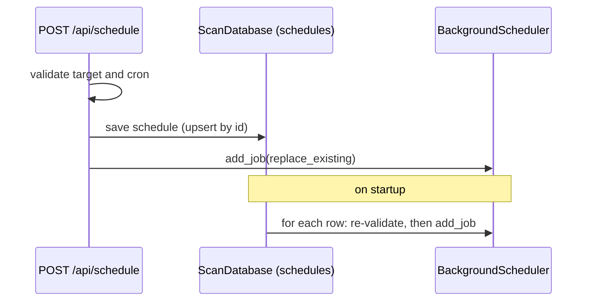

# ADR-0004: Persist scan schedules in the scan database

## Status

Accepted

## Date

2026-11-17

## Context

`POST /api/schedule` adds a cron job to APScheduler's `BackgroundScheduler`. That scheduler uses the default in-memory job store. Every restart therefore loses every schedule: a crash, a host reboot, `docker compose up` after an image update. Nothing reports the loss. Scheduled scans just stop, and `GET /api/schedule` returns an empty list (roadmap item C8).

The app already keeps scan history in SQLite through `ScanDatabase` (`modules/database.py`). In Docker that file lives on the `anansi-data` named volume, so it survives restarts and image updates.

APScheduler is pinned to `>=3.10,<4`. Version 4 is a rewrite with a different job-store API.

## Decision Drivers

- Schedules must survive a restart without any action from the user.
- The schedule API (`POST`, `GET` and `DELETE /api/schedule`) keeps its request and response shapes.
- Nothing read back from the database file should be able to run code. The worst a tampered or corrupt row can do is start a scan of a valid target.
- No new runtime dependency unless it removes more code than it adds.
- Tests run against an in-memory database with no real scheduler thread.

## Options Considered

### Option 1: APScheduler's `SQLAlchemyJobStore` on the same SQLite file

Configure the scheduler with a persistent job store, and APScheduler saves and reloads jobs itself.

- **Good:** No scheduling code of our own. APScheduler also stores each job's next run time and handles missed runs.
- **Bad:**
  - Adds SQLAlchemy, a large dependency, just for this.
  - Jobs are stored as pickles, and loading a pickle runs code. Anyone who can write the database file could run code as the app.
  - Jobs refer to their function by import path, so renaming or moving `_run_scheduled_scan` breaks every stored job.
  - The stored format is APScheduler 3's. Moving to version 4 means migrating the stored jobs.

### Option 2: A `schedules` table owned by `ScanDatabase`

Store each schedule as plain data: `id`, `target`, `cron`, `cve` and `created_at`. The web app writes the row when a schedule is created and deletes it when one is removed. At startup it adds a scheduler job for each row. The scheduler keeps its in-memory store.

- **Good:**
  - No new dependency.
  - Rows are plain data. Each row's target and cron expression are checked again on load with the same `validate_target` and `CronTrigger.from_crontab` the API uses, so a tampered row can at worst schedule a scan of a valid target.
  - Independent of APScheduler's storage format, so moving to version 4 doesn't touch stored data.
  - Testable with `ScanDatabase(':memory:')`.
- **Bad:**
  - About 50 lines of our own code.
  - The table and the scheduler both hold the schedules and must stay in step.
  - A run missed while the app is down is not caught up. That's the same as today.

## Decision

We will use **Option 2**: store schedules in a `schedules` table in the existing scan database, and re-register them with the scheduler at startup.

It meets every driver without a new dependency. It keeps executable data out of the database file, which matters for a security tool whose database sits on a shared volume. The duplicated state is small and has one clear rule: the table is the source of truth, and the scheduler is rebuilt from it.

Details:

- **Create** checks the target and parses the cron expression before writing anything. It then saves the row (replacing any row with the same id) and adds the job. Job ids keep their current form, `scan-{target}-{cron}`.
- **Delete** removes the row and the job. It returns 404 only if neither exists.
- **Startup** loads every row before the scheduler starts. A row that fails validation is logged and skipped, not deleted, so a person can inspect it.
- **List** keeps reading from the scheduler, so it still shows each schedule's next run time.

## Consequences

### Positive

- Schedules survive restarts, crashes and image updates, wherever the scan database is stored.
- No pickles and no new dependency. The scheduler stays replaceable.

### Negative / Trade-offs

- We own a small amount of persistence code and its tests.
- If the app runs with `ANANSI_DB_PATH=':memory:'`, schedules still don't persist. That is consistent with scan history.

### Risks

- If the process dies between saving the row and adding the job, the schedule exists only in the table. The next startup loads it, which is the intended outcome.
- Two app instances sharing one database file would both run every schedule. The app is designed for a single instance, and running more than one is not supported.

## Links

- Roadmap item C8 (`ROADMAP.md`, Audit Remediation, Phase 4)
- Roadmap item H1 (ADRs for existing decisions, including APScheduler)
- [APScheduler 3.x job stores](https://apscheduler.readthedocs.io/en/3.x/userguide.html#choosing-the-right-job-store)
