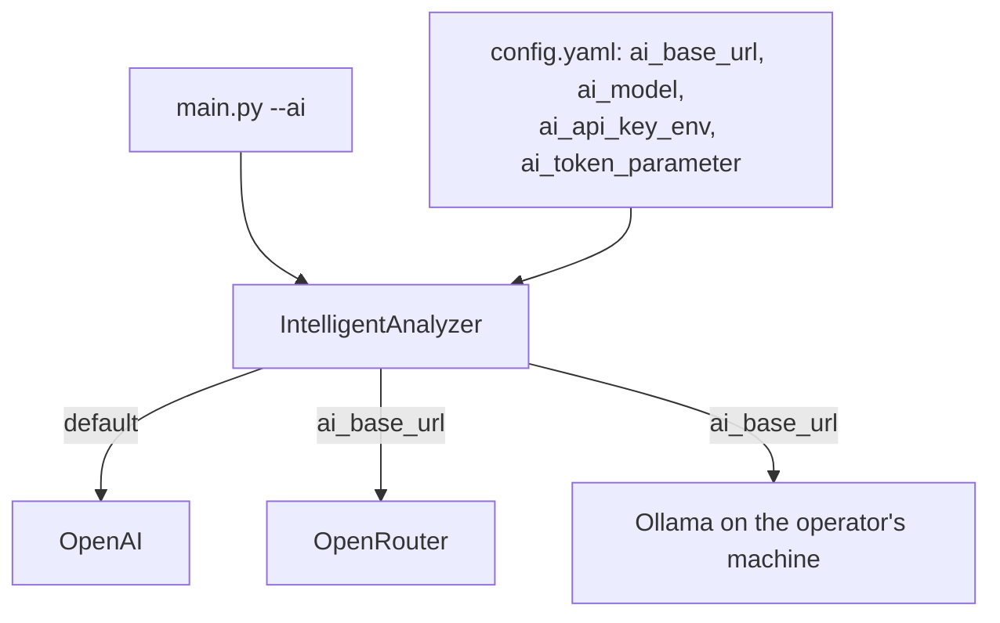

# ADR-0005: Send AI analysis to a configurable OpenAI-compatible endpoint

## Status

Accepted

## Date

2026-11-17

## Context

`--ai` sends scan results to OpenAI's Chat Completions API. The base URL, the API key's environment variable (`OPENAI_API_KEY`) and the token-limit parameter (`max_completion_tokens`) are all hard-coded in `modules/intelligence.py`. Only the model can be configured (`ai_model`).

That makes OpenAI the only destination for scan data. For a security tool this matters: a scan lists a client's hosts, open ports and software versions, and some engagements forbid sending that to a third party at all. Others would prefer a different hosted provider.

A spike on 2026-11-17 tested the alternatives with the app's real prompt and a scan that contained vsftpd 2.3.4, OpenSSH 7.2p2, telnet, Apache httpd 2.4.49 and a banner that tried a prompt injection:

- **Ollama (local)** serves an OpenAI-compatible API. The current request works unchanged against it apart from the base URL, with either `max_tokens` or `max_completion_tokens`. With `qwen3.5` (9.7B) on an M2 Pro, four runs never obeyed the injected banner and found the telnet and OpenSSH issues. But every run missed the Apache 2.4.49 path traversal (CVE-2021-41773) and the vsftpd 2.3.4 backdoor, one run cited a CVE that does not belong to vsftpd, and each run took 65–132 seconds.
- **OpenRouter** serves the same API for 470 models with one key, including `openai/gpt-6-luna` at OpenAI's price. 453 of its models accept `max_tokens`, but only 90 accept `max_completion_tokens`. Requests can require zero-data-retention providers (`provider.zdr`), but by default they may be routed to providers that retain prompts.
- **OpenAI** could not be tested because the account has no credits. It requires `max_completion_tokens` for reasoning models such as `gpt-6-luna`.

The spike also found that the analysis quality problem is mostly ours, not the provider's. `IntelligentAnalyzer` builds its prompt from raw nmap output and sends only the service name and version, so the model reads `http 2.4.49` rather than `Apache httpd 2.4.49`. It also never sees the CVEs that `--cve` has already looked up in NVD, so it has to recall vulnerabilities from memory, which is where the local model failed. Fixing that is tracked separately in the roadmap and is not part of this decision.

## Decision Drivers

- Operators must be able to keep scan data on their own machine or network.
- The default for existing users keeps working without a config change.
- No new runtime dependency unless it removes more code than it adds.
- An API key is never sent in clear text.
- Analysis code stays testable without network access.

## Options Considered

### Option 1: Keep OpenAI as the only provider

- **Good:** No work. One provider to document and test.
- **Bad:** Scan data can only go to OpenAI. Operators who cannot send client data to a third party cannot use `--ai` at all.

### Option 2: A configurable OpenAI-compatible endpoint

Keep the `openai` SDK and make the endpoint configurable: base URL, model, the name of the environment variable that holds the key, and which token-limit parameter to send. OpenAI, OpenRouter, Ollama, vLLM, LM Studio and llama.cpp's server all speak this API.

- **Good:**
  - About 30 lines of change and no new dependency.
  - Covers local, hosted aggregator and direct OpenAI with one code path.
  - The current behaviour becomes the default values of the new settings.
- **Bad:**
  - Providers differ in details the API does not hide, such as the token parameter. Each difference becomes a setting.
  - Provider-specific options, such as OpenRouter's per-request `provider` routing, are out of reach without another setting.
  - Providers that only offer their own API, such as Anthropic's Messages API or Google's Gemini API, are reachable only through a compatibility layer or an aggregator.

### Option 3: A provider port with an adapter per provider, or LiteLLM

Define an `Analyst` port in the domain and write an adapter for each provider's own API, or use LiteLLM, which already wraps about 100 providers.

- **Good:** Each provider's own features are available. Any provider can be added.
- **Bad:**
  - Writing adapters means owning and testing code for providers nobody has asked for yet.
  - LiteLLM is a large dependency with a fast release cadence, for a feature that makes one request per scan.

## Decision

We will use **Option 2**: send AI analysis to a configurable OpenAI-compatible endpoint, with **OpenAI as the default**.

It removes the only hard blocker (scan data can only go to OpenAI) with the smallest change, and every tool the spike tested already speaks this API. Option 3 can follow if someone needs a provider that has no compatible endpoint; the settings below would then map onto one adapter among several.

OpenAI stays the default because the spike found the local model too weak to recommend as a default, and OpenRouter's default routing may retain prompts. Operators choose local or OpenRouter deliberately, knowing the trade-off.

Settings, in the `default` section of `config.yaml`:

| Setting | Default | Meaning |
|---|---|---|
| `ai_base_url` | not set (OpenAI) | Base URL of the Chat Completions API, for example `http://localhost:11434/v1` for Ollama or `https://openrouter.ai/api/v1` |
| `ai_model` | `gpt-6-luna` | Model name as the endpoint expects it, for example `qwen3.5` or `openai/gpt-6-luna` |
| `ai_api_key_env` | `OPENAI_API_KEY` | Name of the environment variable that holds the key. The key itself never goes in `config.yaml` |
| `ai_token_parameter` | `max_completion_tokens` | `max_completion_tokens` or `max_tokens`; any other value is a configuration error |

Rules:

- When `ai_base_url` is not set, the key is required, as today.
- When `ai_base_url` is set, the key is optional, because local servers don't use one. The SDK still needs a value, so a fixed placeholder is sent instead.
- A key is only ever sent over HTTPS. If `ai_base_url` uses `http://` and the key's variable is set, analysis is refused with an error, rather than sending the key in clear text.
- The log line and the "skipped" message name the endpoint's host rather than "OpenAI".

## Consequences

### Positive

- Operators can keep scan data on their own machine by pointing `ai_base_url` at a local server.
- One OpenRouter key gives access to many models without code changes.
- Existing configurations keep working: every new setting defaults to today's behaviour.

### Negative / Trade-offs

- Four settings to document and validate instead of one.
- Analysis quality now depends on a model the operator picks. A small local model gives generic advice and can invent CVE numbers, so the README must say so.
- OpenRouter's privacy controls (`provider.zdr`, `data_collection`) are not exposed. Operators who use OpenRouter must set their data policy in their OpenRouter account.

### Risks

- `ai_base_url` decides where scan data goes. It is read only from `config.yaml`, never from the web API or scan input, so changing it requires write access to the config file.
- A compatible endpoint can still reject a parameter the app sends. The error is returned as the analysis text, as API errors are today, so a scan never fails because of it.

## Links

- Roadmap item C10 (`ROADMAP.md`, Audit Remediation, Phase 4): the move to `gpt-6-luna` and `max_completion_tokens`
- Roadmap items A1 and A2 (`ROADMAP.md`, Audit Remediation, Phase 6)
- Roadmap item S7: banners are untrusted data in the prompt
- [OpenAI Chat Completions API](https://platform.openai.com/docs/api-reference/chat)
- [Ollama OpenAI compatibility](https://docs.ollama.com/api/openai-compatibility)
- [OpenRouter provider routing](https://openrouter.ai/docs/features/provider-routing)
