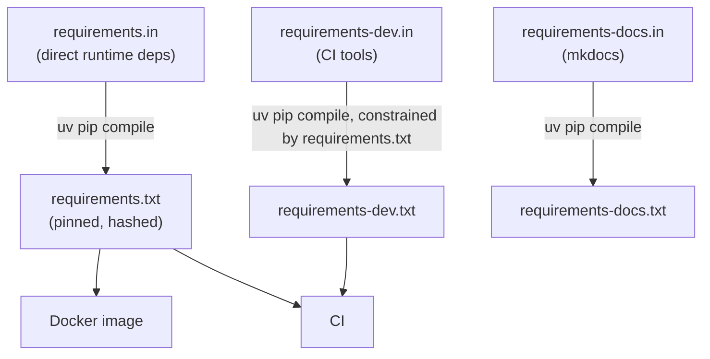

# ADR-0010: Pin dependencies with a hashed universal lockfile compiled by uv

## Status

Accepted

## Date

2026-11-17

## Context

`requirements.txt` lists 25 packages, nearly all with only a lower bound (`fastapi>=0.115.0`). Pip installs whatever is newest when it runs. The Docker image, each CI job and each contributor's environment can therefore get different versions, and a broken or compromised release reaches the image on its next build without any change in this repository (roadmap item H4).

Other gaps:

- `requirements.txt` also installs mkdocs, Markdown and Pygments into the runtime image, although nothing at runtime uses them.
- CI installs its tools unpinned: flake8, bandit, pip-audit, mypy, pypdf and the type stubs.
- CI tests on Python 3.10, 3.11 and 3.12; the image uses 3.12. Some packages need older versions on 3.10.

`tests/infra/test_packaging.py` checks that every third-party import in the runtime code is declared in `requirements.txt`.

A trial compile on 2026-11-17 with `uv pip compile --universal --python-version 3.10 --generate-hashes` produced one file that pins 55 packages with hashes. Where 3.10 needs different versions, it pins both under environment markers (`fastapi==0.162.5 ; python_full_version < '3.11'`).

## Decision Drivers

- The image, CI and contributors install the same versions.
- A package changed on PyPI after locking fails to install rather than installing.
- One lock that works on every Python version CI tests.
- No change to how the Dockerfile, CI and pip-audit install packages, if possible.
- Updating a version is one command.

## Options Considered

### Option 1: pip-tools (`pip-compile --generate-hashes`)

- **Good:** Long established. Produces a plain requirements file.
- **Bad:** Resolves for the Python version it runs on. Because 3.10 needs different pins, that means one lockfile per Python version, or locking on 3.10 and holding 3.11 and 3.12 back to 3.10's versions.

### Option 2: `uv pip compile --universal --generate-hashes`

Keep direct dependencies in `requirements.in`, and compile them into a hashed `requirements.txt` that covers every supported Python version.

- **Good:**
  - One lockfile for 3.10–3.12, with markers where versions differ.
  - The output is a requirements file, so the Dockerfile, CI and pip-audit keep running `pip install -r requirements.txt`. Only someone updating the lock needs uv.
  - Re-compiling keeps the existing pins unless asked to upgrade, so CI can check that the lock matches `requirements.in`.
- **Bad:**
  - Contributors who change dependencies need uv installed.
  - Two files per set of dependencies, and editing the wrong one is easy. The CI check catches it.

### Option 3: A uv project (`pyproject.toml` and `uv.lock`)

- **Good:** uv's native workflow, with dependency groups for dev and docs tools in one lock.
- **Bad:** The Dockerfile and CI must install with uv instead of pip, and pip-audit cannot read `uv.lock` directly. Larger change for the same guarantee.

## Decision

We will use **Option 2**: direct dependencies in `.in` files, compiled with `uv pip compile --universal --python-version 3.10 --generate-hashes` into hashed requirements files.

It gives a reproducible, hash-checked install on every Python version CI tests, and nothing that installs packages has to change. Option 3 can follow if the project adopts `pyproject.toml` for other reasons.

Details:

- **Three sets:**
  - `requirements.in` lists runtime dependencies only.
  - `requirements-dev.in` lists the CI tools. It is compiled with `requirements.txt` as constraints, so the tools never change a runtime pin.
  - `requirements-docs.in` lists mkdocs and its plugins, which leave the runtime image.
- **One script,** `scripts/lock-requirements.sh`, compiles all three. Passing `--upgrade` or `--upgrade-package NAME` through to uv updates versions.
- **CI checks the locks are current:** it re-compiles into a temporary directory and fails if the result differs from the committed files.
- **Lower bounds stay in the `.in` files** as the minimum versions the code needs, such as `starlette>=1.0.1` for a security fix.
- **The packaging contract test** reads `requirements.in`, so every runtime import must be a *direct* dependency, not one that happens to be pulled in by another package.

## Consequences

### Positive

- Builds are reproducible, and pip refuses a package whose hash doesn't match.
- The runtime image no longer contains documentation tooling.
- pip-audit checks the exact versions that ship.

### Negative / Trade-offs

- Security fixes no longer arrive by themselves. pip-audit in CI flags a vulnerable pin, and someone runs the lock script with `--upgrade-package`.
- Changing dependencies takes two steps: edit the `.in` file, then run the script.

### Risks

- A lock compiled for 3.10–3.12 may not resolve on a newer Python. Adding a version to the CI matrix means re-locking with it in range.
- Hash-checking mode rejects any requirement without a hash. Packages installed outside the lock, such as by a new `pip install` line in CI, must go through one of the `.in` files.

## Links

- Roadmap item H4 (`ROADMAP.md`, Audit Remediation, Phase 5)
- Roadmap item D1: the packaging contract test
- [uv: locking requirements](https://docs.astral.sh/uv/pip/compile/)
- [pip secure installs (hash-checking mode)](https://pip.pypa.io/en/stable/topics/secure-installs/)
