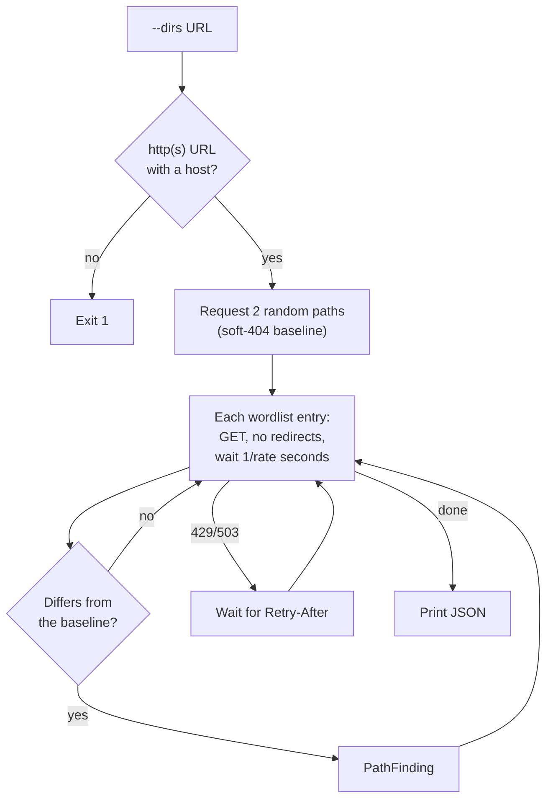

# ADR-0012: Discover web directories with a rate-limited, opt-in scanner built on requests

## Status

Accepted

## Date

2026-11-18

## Context

Roadmap proposal #7 ("The Web Weaver") asks for subdomain and directory discovery. `--dns` already brute-forces subdomains from a built-in list of 23 names. Nothing yet looks for hidden paths on a web server, such as `/admin/`, `/.git/` or `/backup.zip`. Those are often the most direct findings on a web host.

Directory discovery differs from Anansi's other checks in three ways:

- **Volume.** It sends one HTTP request per wordlist entry. Common lists hold 4,000–220,000 entries, so a careless run can overload a small server, fill its logs or trip a WAF. Every other module sends a few requests per service.
- **Scope.** It takes a URL, not an IP or CIDR range, so `validate_target` doesn't cover it. Redirects can lead to other hosts.
- **False positives.** Many servers answer 200 for every path (a "soft 404"), so status codes alone mark every word as found.

Anansi already has patterns for the related problems:

- `--exploit` is opt-in and never run by the web dashboard (roadmap E1).
- `VulnLookup` waits between requests to respect a rate limit.
- `requests` is already a runtime dependency.
- Results are typed records (ADR-0003).

## Decision Drivers

- No surprise traffic: nothing runs unless asked for, and the default pace is gentle.
- Requests stay on the host the user named.
- Few false positives on soft-404 servers.
- No new runtime dependency or external binary, if possible.
- The wordlist can be swapped without a code change, and what ships with Anansi has a compatible license.
- Testable without a network.

## Options Considered

### Option 1: Wrap an external tool (gobuster, ffuf, feroxbuster)

Run the binary as nmap is run, and parse its JSON output.

- **Good:** Fast, mature, with soft-404 handling and recursion built in.
- **Bad:**
  - Another binary to install on every host and in the Docker image, in Go or Rust, with its own release cycle.
  - Its options and output format become part of Anansi's interface.
  - The Docker smoke test and supply-chain checks (hashed lockfiles, pip-audit) don't cover it.

### Option 2: Concurrent async scanner (httpx or aiohttp)

- **Good:** Hundreds of requests in flight, so large wordlists finish quickly.
- **Bad:**
  - A new runtime dependency.
  - Asynchronous code alongside the otherwise synchronous modules.
  - Speed is the opposite of the "gentle by default" driver. A rate limit would cap it to a few requests per second anyway.

### Option 3: Sequential scanner on `requests` with a fixed request rate

A `DirectoryScanner` module, in the style of `DNSEnumerator`, sends one request at a time with a delay between them.

- **Good:**
  - No new dependency or binary.
  - Simple, deterministic code that is easy to test with a mocked session.
  - The rate limit is the design, not a cap on top of it.
- **Bad:**
  - Slow on large lists: 4,700 words at 10 requests per second take about 8 minutes.
  - No recursion into found directories in the first version.

## Decision

We will use **Option 3**, a sequential, rate-limited `DirectoryScanner` built on `requests`. The default rules:

- **Opt-in:** a new `--dirs URL` flag. The web dashboard doesn't expose it, as with `--exploit`.
- **Scope:**
  - The URL must be `http` or `https`, and its host must be an IP address or a host name.
  - Redirects are not followed. A 301/302 is reported with its `Location`, so a redirect can never send requests to another host.
  - Only paths under the given URL are requested. There is no crawling.
- **Rate:**
  - 10 requests per second by default, set with `dirs_rate` in `config.yaml` and capped at 50.
  - A `429` or `503` with `Retry-After` pauses the scan for that long.
  - Three consecutive connection errors stop the scan.
- **Soft-404 detection:** before the scan, request two random paths that cannot exist. A word counts as found only if its response differs from that baseline in status code, or in body length by more than a small margin.
- **Wordlist:**
  - A built-in list of about 100 common paths, written for Anansi so its license is clear.
  - `--wordlist FILE` uses any other list, such as SecLists. Anansi doesn't ship third-party lists.
- **Requests:**
  - `GET` with a 10-second timeout and a `User-Agent` that names Anansi, so the target's logs show what made the requests.
  - TLS certificates are verified unless `dirs_verify_tls: false` is set in `config.yaml`, for internal hosts with self-signed certificates.
- **Results:**
  - A typed `PathFinding` record (URL, status, length, `Location` for redirects), printed as JSON.
  - `--pdf` and `--compliance` don't use them in the first version.

Option 1 adds an unaudited binary to a security tool's supply chain. Option 2 adds a dependency to reach a speed the rate limit forbids. Option 3 meets every driver with code that already fits the project. Recursion and concurrency can come later, once real use shows they're needed.

## Consequences

### Positive

- Anansi finds exposed paths without new dependencies or binaries.
- The default pace and the `User-Agent` make a run easy to recognise and unlikely to harm the target.
- The scanner is fully testable with a mocked `requests.Session`.

### Negative / Trade-offs

- Large wordlists are slow by design. Users who need speed can raise `dirs_rate` up to the cap, or use a dedicated tool.
- No recursion: paths inside a found directory need another run with that directory as the URL.
- The soft-404 check compares status and length only, so pages with dynamic content (timestamps, tokens) can still give false positives.

### Risks

- Users may point `--dirs` at hosts they aren't authorized to test. As with every other flag, the README's authorization warning applies, and the `User-Agent` makes the run attributable.
- A WAF can still block the scanning IP at 10 requests per second. Lowering `dirs_rate` is the remedy.

## Links

- Roadmap proposal #7 (`ROADMAP.md`) and "Recommended Next Step"
- [ADR-0003](0003-model-scan-results-as-typed-finding-records.md): typed result records
- Roadmap item E1: opt-in `--exploit`, which the dashboard never runs
- [SecLists](https://github.com/danielmiessler/SecLists) (MIT), a source of larger wordlists for `--wordlist`
