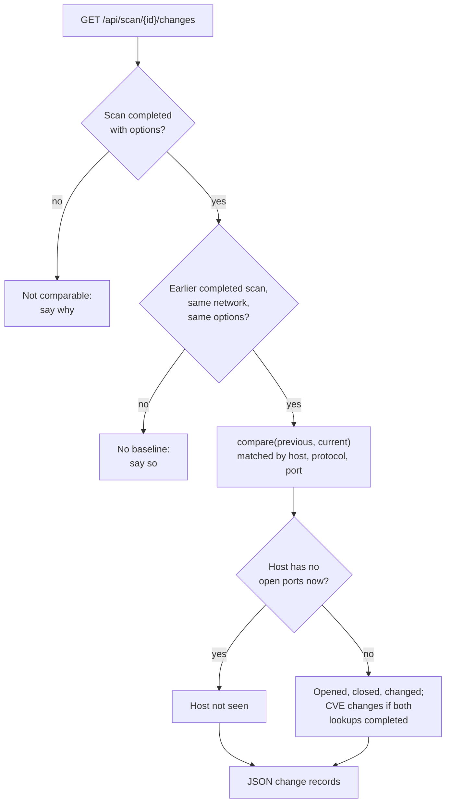

# ADR-0013: Report changes between a scan and the previous comparable scan of the same target

## Status

Accepted

## Date

2026-11-24

## Context

Roadmap proposal #5 asks Anansi to show what changed over time, such as "new ports opened since last week". The dashboard already has what that needs:

- Every dashboard scan, manual or scheduled, is saved in the `scans` table as JSON `Finding` records ([ADR-0003](0003-model-scan-results-as-typed-finding-records.md), [ADR-0008](0008-store-scan-history-in-sqlite.md)).
- Scheduled scans persist and run on their own ([ADR-0004](0004-persist-scan-schedules-in-the-scan-database.md), [ADR-0009](0009-run-scheduled-scans-with-apscheduler-in-the-dashboard-process.md)).

Nothing compares one scan with another, so a user has to open two scans and compare them by eye.

Two scans of the same target are not always comparable:

- **Different scans.** These all change what a scan reports, even when nothing on the host changed:
  - The CVE lookup is optional per scan.
  - `exclude_ports` can change in `config.yaml` between scans.
  - The nmap scan type depends on privilege: `-sS` as root, `-sT` otherwise (the Docker image runs as non-root). Unprivileged scans with excluded ports also skip host discovery with `-Pn` (`modules/scanner.py`).

  The `scans` table records none of this. `max_threads` doesn't matter: nmap ignores it.
- **Port states.** `ServiceEnumerator` turns every port nmap lists into a `Finding` without reading its state. nmap also lists closed and filtered ports when they aren't the majority on a host, so today's findings can include ports that aren't open.
- **Failed CVE lookups.** `VulnLookup` turns any NVD error, including a rate limit, into an empty CVE list, which is indistinguishable from "no CVEs". It also keeps only the first 5 keyword matches, so a newly published CVE can push an older one out.
- **Hosts disappear.** If a host is down or filtered during one scan, every port it had looks closed, though nothing on the host may have changed.
- **Spellings of a target.** Targets are validated as an IP address or CIDR range, but stored as typed. `10.0.0.0/24` and `10.0.0.7/24` name the same network, as do `10.0.0.5` and `10.0.0.5/32`.
- **Old history.** Scans saved before 0.2.0 use the old results shape, keyed by port.

The dashboard's history is small: one row per scan, read back whole.

## Decision Drivers

- No false alarms: a difference in how two scans ran, or a host that didn't answer, must not show up as a change on the host.
- The comparison logic is pure domain code, testable without a database or network.
- No new dependency, and no migration beyond what `sqlite3` can do in `_init_db`.
- The same change records can later feed a view of status over time.

## Options Considered

### Option 1: Compute the changes when they're read

Add a pure function in `domain/` that takes two lists of `Finding` records and returns typed change records. An API route loads the scan and the previous comparable scan, and calls the function.

- **Good:**
  - Nothing new is stored, so changes always reflect the current comparison rules, and fixing a bug in them fixes every past comparison.
  - The core logic is pure and easy to unit-test.
  - It works for every scan saved after the new column is added.
- **Bad:**
  - Each request parses two JSON blobs. That's negligible at the dashboard's scale, but a long timeline would parse many.

### Option 2: Compute the changes when a scan completes and store them

When a scan finishes, compare it with the previous one and save the result in a new `scan_changes` table.

- **Good:** Reads are a single query, and a timeline needs no recomputation.
- **Bad:**
  - The stored changes freeze the rules of the day. Fixing a bug in them, or adding a new comparability condition, needs a backfill.
  - It writes a second copy of data that is already in `scans`.

### Option 3: Store findings as rows and compare them in SQL

Move results out of the JSON column into a `findings` table (scan id, host, protocol, port, service, product, version) and a `cves` table, then compare with joins.

- **Good:** Comparisons and trend queries become SQL, and scale to large histories.
- **Bad:**
  - It reverses ADR-0008's choice to keep results as JSON, and needs a data migration of every stored scan.
  - It needs much more schema and code than the problem needs at one row per scan.

## Decision

We will use **Option 1**: compute changes on read with a pure domain function.

**Before this ships**, `ServiceEnumerator` keeps only ports whose nmap state is `open`. That is a bug fix in its own right (closed ports also get CVE lookups and appear in reports today), and it ships separately with its own failing test.

**What a scan records.** A new `options` column on `scans` holds JSON, written when the row is created:

- `nmap_arguments`: the arguments the scanner actually passed to nmap. This covers the scan type, `-Pn` and the excluded ports in one value. The scanner sorts and de-duplicates excluded ports so the same setting always gives the same string.
- `cve_lookup`: whether the CVE lookup ran.
- `cve_lookup_complete`: false if any NVD request failed during the scan. `VulnLookup` reports failures instead of hiding them in an empty list.

`_init_db` checks `PRAGMA table_info(scans)` and runs `ALTER TABLE scans ADD COLUMN options TEXT` if the column is missing, inside its existing locked transaction. Rows saved before this have no options.

**Comparable scans.** A scan is compared with the most recent earlier scan that:

- has status `completed`;
- names the same network, compared as `ipaddress.ip_network(target, strict=False)`;
- has the same `nmap_arguments` and `cve_lookup`.

"Most recent earlier" means the highest id below this scan's. The dashboard runs one scan at a time, so id order is start order. Rows without options never qualify, which also keeps old-shape results out. If there is no comparable scan, the answer says so instead of listing every finding as new.

**Matching.** Findings are matched by host, protocol and port. The comparison reports:

| Change | Meaning |
|---|---|
| Opened | the port is open now and wasn't before |
| Closed | the port was open before, isn't now, and its host still has other open ports |
| Changed | service, product or version differ, with before and after values |
| CVEs added | a CVE ID is listed now and wasn't before. Reported even if the version is unchanged, because NVD may have published it since |
| CVEs removed | a CVE ID was listed before and isn't now, **and** the product or version changed. With the same version, a missing CVE means NVD's top 5 matches shifted, not that anything was fixed |
| Host not seen | a host had open ports before and none now. Its ports are listed under the host, not as closed. Anansi can't tell a host that didn't answer from one that was shut down, and "not seen" is accurate for both |

CVE changes are reported only when both scans have `cve_lookup_complete`. Otherwise the answer says that CVEs weren't compared, and why.

**Where it shows.**

- A new route, `GET /api/scan/{id}/changes`, returns the baseline scan's id and date and the change records. It returns:
  - 404 for an unknown id (FastAPI already rejects a non-integer id with 422);
  - "not comparable", with the reason, for a scan that is running, failed, or has no options.
- A `findings_from_json` in `domain/findings.py` rebuilds `Finding` records from stored JSON, alongside `findings_to_json`.
- The route sits behind the same authentication as every other API route ([ADR-0001](0001-require-a-session-backed-api-key-for-every-dashboard-and-api-route.md)).
- The dashboard shows a "Changes since <date>" panel for the most recent completed scan, read from the database so it survives a restart. Opening older scans from the history table is a later change.

**Not in this decision:**

- **CLI.** The CLI doesn't store scans, so it has nothing to compare.
- **Status over time.** A chart of how a target changed across many scans is a separate decision, because it needs a charting approach that works under the dashboard's strict CSP ([ADR-0002](0002-serve-dashboard-styles-and-scripts-from-the-app-with-a-strict-csp.md)). It will build on the comparability rule and change records here.

Option 2 stores a copy that drifts from its source whenever the rules change. Option 3 reverses ADR-0008 to solve a scaling problem the app doesn't have. Option 1 needs one column and a pure function, and can move to stored or SQL-based changes later if history grows.

## Consequences

### Positive

- Scheduled scans become monitoring: a user sees what changed, not just what exists.
- The comparison is a pure function, testable with plain `Finding` lists.
- No new dependency, and only one new column.
- Fixing the port-state bug and surfacing failed CVE lookups also make every existing report more accurate.

### Negative / Trade-offs

- Scans saved before this change can't be compared, so the first comparison appears after the second scan that has options recorded.
- A `10.0.0.5` scan isn't compared with the same host inside a `10.0.0.0/24` scan.
- Changing `exclude_ports`, or switching between root and non-root, starts a new baseline, so the next scan shows no changes.
- One failed NVD request suppresses CVE changes for the whole scan, rather than for one finding.

### Risks

- nmap's version detection can vary between runs, for example a version string with or without a patch level. That would show as a version change on an unchanged service. If it proves noisy, a later change can compare normalised versions.
- A filtered host, or one that answers on some ports but not others, can still produce false closed ports. "Host not seen" only covers a host with no open ports at all.
- The top-5 CVE cap can still hide a real removal when the version changed, or show a CVE as added only because another dropped out of the top 5. Raising the cap is a separate change to `VulnLookup`.

## Links

- Roadmap proposal #5 (`ROADMAP.md`)
- [ADR-0003](0003-model-scan-results-as-typed-finding-records.md): typed `Finding` records
- [ADR-0008](0008-store-scan-history-in-sqlite.md): scan history in SQLite, results as JSON
- [ADR-0009](0009-run-scheduled-scans-with-apscheduler-in-the-dashboard-process.md): scheduled scans
- [ADR-0002](0002-serve-dashboard-styles-and-scripts-from-the-app-with-a-strict-csp.md): the dashboard's CSP, relevant to the status-over-time view
