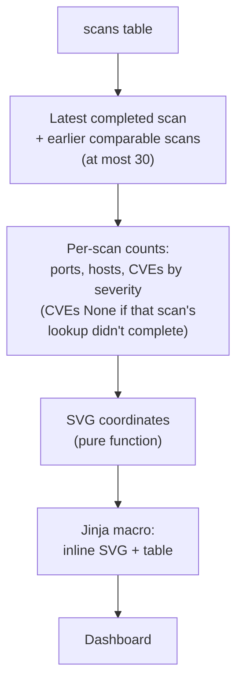

# ADR-0014: Show status over time as server-rendered SVG line charts

## Status

Accepted

## Date

2026-11-27

## Context

[ADR-0013](0013-report-changes-between-a-scan-and-the-previous-comparable-scan-of-the-same-target.md) shows what changed between one scan and the previous comparable scan. It doesn't show the trend: whether a target's exposure is going up or down across weeks of scheduled scans. Roadmap proposal #5 and the "Changes between scans" follow-up ask for that view.

The dashboard constrains how a chart can be drawn:

- **Strict CSP.** Every response sends `default-src 'self'` ([ADR-0002](0002-serve-dashboard-styles-and-scripts-from-the-app-with-a-strict-csp.md)). With no `style-src`, inline `style` attributes and `<style>` elements are blocked too. `tests/modules/test_web_csp.py` rejects them in templates. ADR-0002 removed the Tailwind CDN so that the dashboard loads nothing it doesn't serve itself.
- **Small frontend.** The page is server-rendered Jinja with one 81-line script (`app.js`) for the scan form and progress stream. There is no build step and no JavaScript test setup.
- **No hand-rolled interactive widgets.** Focus, keyboard navigation and tooltips come from native elements or an established library, not bespoke code.
- **Comparable scans only.** ADR-0013 established that two scans can differ just because they ran differently. A trend line that mixes a root scan with a non-root one would show port jumps that aren't on the host. One that mixes scans with and without the CVE lookup would show CVE jumps that aren't on the host.
- **CVE counts are approximate.** Each finding holds at most NVD's top 5 keyword matches for its detected product and version (`modules/vuln_lookup.py`). A CVE count can therefore move when NVD's ranking or nmap's version guess changes, and it caps at 5 per port. Port and host counts don't depend on either.
- **Severity is free text.** A `Cve.severity` is NVD's `baseSeverity` (`CRITICAL`, `HIGH`, `MEDIUM`, `LOW` or `NONE`) or `UNKNOWN` when NVD gives none. CVEs scored only with CVSS v2 also come out `UNKNOWN` today, because the parser looks for v2's severity in the wrong place. That's a separate bug.

## Decision Drivers

- The charts are easy to read correctly: a rise or fall in ports means the target changed, and the CVE chart says what its counts can and can't show.
- They work under the existing CSP with no new third-party code.
- They're accessible: there's a text alternative, they don't depend on colour alone, and the lines meet contrast requirements.
- The data behind them is computed by pure, unit-testable code.
- No new runtime dependency.

## Options Considered

### Chart form

- **3D radar chart** (suggested as easy to interpret). Rejected:
  - Perspective distorts: nearer values look bigger, and some points hide others.
  - A radar's filled area changes with the order of its axes, so equal values can look different.
  - One polygon per scan, stacked in depth, becomes unreadable after a few scans.
- **One line chart with two y axes**, ports on one and CVEs on the other. Rejected: where the lines cross depends on how each axis is scaled, which invites false comparisons.
- **Two small line charts**, one per kind of measure, with scans along the x axis. Chosen: people read the direction and size of change correctly without explanation.

### Option 1: Server-rendered inline SVG

Python computes each scan's counts and the chart's coordinates. A Jinja macro writes an `<svg>` with `<polyline>` and `<circle>` elements straight into the page. A table of the same numbers follows each chart.

- **Good:**
  - No JavaScript and no dependency. The CSP doesn't govern SVG presentation attributes such as `stroke` or `<title>` elements, so it stays as it is.
  - The counts and coordinates come from pure functions, testable without a browser.
  - The chart is in the HTML, so it shows without waiting for a script, and tests can assert on it.
- **Bad:**
  - Interaction is limited to what SVG and HTML give natively: hover titles and links. There's no zoom or crosshair.
  - We write and maintain the axis and scaling code ourselves (about 100 lines).

### Option 2: A charting library served from `/static`

Vendor a library such as uPlot (about 50 KB) or Chart.js (about 200 KB) into `web/templates/static/`, pinned and checked by hash. A JSON route feeds it.

- **Good:** Rich interaction (zoom, tooltips, legends) and polished axes without writing them.
- **Bad:**
  - It brings third-party code back into a dashboard that ADR-0002 deliberately emptied of it, and every update needs a review.
  - The interaction we'd gain isn't needed for a handful of lines over tens of scans.

### Option 3: Client-side SVG drawn by `app.js`

Add a JSON route and draw the SVG in the browser with our own script.

- **Good:** No third-party code. The chart can redraw without a page load.
- **Bad:**
  - It's the same drawing code as Option 1, but in JavaScript, which the project can't test.
  - The chart appears only after the script runs and the data arrives.

## Decision

We will use **Option 1**: two line charts drawn as inline SVG on the server.

**The two charts.**

- **Open ports:** two lines.
  - Open ports: one per host, protocol and port.
  - Hosts with at least one open port. This line shows a host that dropped out of a scan, so a dip in ports can be told apart from ports closing.
- **CVEs by severity:** one line each for critical, high, medium, low and other. Severity is matched case-insensitively, and "other" covers `NONE` and `UNKNOWN`. Each CVE is counted once per finding it appears on, so a CVE on two hosts counts as two exposures. A sentence under the chart says what the counts mean: "Counts are NVD's top 5 matches per service; they can change when NVD's results or the detected version change."

**Which scans.** The series is the latest completed scan and the earlier scans comparable with it under ADR-0013's rule (same network, same nmap arguments, CVE lookup on or off in both), at most 30 in all. ADR-0013's rule is plain equality, so every scan in the series is comparable with every other.

There's no chart when:

- the latest completed scan has no recorded options;
- the series has fewer than two scans.

**X axis.** Scans are spaced evenly in id order, which is start order, not by time. Schedules and manual scans mix, and even spacing keeps bunched points readable. The first and last dates label the axis, and each point's title and table row give its date.

**Gaps, not zeros.** A scan whose own CVE lookup didn't complete (`cve_lookup_complete` is false) has no point on the CVE chart, and its lines break there. Drawing it as zero would invent a drop. The CVE chart isn't shown when:

- the series didn't look up CVEs. A sentence says why.
- fewer than two scans have a CVE point.

**Where it shows.** Under the "Changes since" panel on the dashboard.

**Accessibility.**

- Each `<svg>` has `role="img"`, a `<title>`, `aria-labelledby` pointing at it, and `aria-describedby` pointing at its table.
- The table holds the same numbers and is the accessible way to read them. Point `<title>`s are a mouse convenience only: keyboards can't reach them, and screen readers handle them inconsistently.
- Each line is labelled at its end, so colour isn't the only way to tell the lines apart.
- Lines use colours with at least 3:1 contrast against `--surface` (WCAG 1.4.11). Critical gets its own lighter stroke colour, because `--critical` (#b91c1c) is only 2.3:1 against it. Low and other get new colour tokens.
- Page tests check the role, the labels and that the table is present.

Points don't link to their scan yet, because no page shows an older scan. Adding one is the separate "open older scans from history" item, and the points can link to it then.

**Code, by layer.**

| Layer | Piece |
|---|---|
| `domain/` | A pure function takes each scan's findings and its `cve_lookup_complete`, and returns per-scan counts. CVE counts are `None` where that scan's lookup didn't complete. |
| `modules/` | A function loads the series from the database, next to `changes_since_previous_scan`. |
| `web/` | A pure function turns the counts into SVG coordinates and axis labels. |
| Template | A Jinja macro in a `.html` file directly in `web/templates/`, so autoescaping and the CSP template tests cover it. It uses no `<style>` element. |
| `app.css` | Colours as CSS classes, next to the existing severity tokens. An inline `style` would break the CSP. |

Option 2 reverses ADR-0002 to get interaction these charts don't need. Option 3 moves the same code to where it can't be tested. Option 1 is the smallest change that keeps the CSP and the test coverage.

## Consequences

### Positive

- Users see whether a target's exposure is going up or down without opening scans one by one.
- No new dependency, no JavaScript, and the CSP is unchanged.
- The counts and coordinates are unit-tested, and the page tests can assert on the rendered SVG.

### Negative / Trade-offs

- No zoom, panning or crosshair. Hover titles and the table are the only ways to read exact values.
- We own about 100 lines of axis and scaling code.
- Only one series is shown: the one the latest scan belongs to.
- Changing how scans run starts a new series, so the charts disappear until the new series has two scans, as the changes panel does.
- Even spacing hides how far apart scans were. The dates in titles and the table give it.

### Risks

- The CVE lines can move without the host changing: NVD's ranking changes, nmap's version guess changes, or a service hits the 5-CVE cap. The note under the chart says so. Raising the cap, or comparing normalised versions, would be changes to `VulnLookup` and ADR-0013's matching.
- A host that drops out of one scan shows as a dip in both ports and hosts. The hosts line makes the cause visible.
- Thirty scans with many hosts each mean parsing thirty JSON blobs per page load. That's fine at the dashboard's scale. If it gets slow, the counts can be stored when a scan completes.

## Links

- [ADR-0013](0013-report-changes-between-a-scan-and-the-previous-comparable-scan-of-the-same-target.md): comparable scans and changes
- [ADR-0002](0002-serve-dashboard-styles-and-scripts-from-the-app-with-a-strict-csp.md): the dashboard's CSP and no third-party code
- [ADR-0008](0008-store-scan-history-in-sqlite.md): scan history storage
- Roadmap proposal #5 (`ROADMAP.md`)
- [WCAG 2.2, 1.4.11 Non-text Contrast](https://www.w3.org/WAI/WCAG22/Understanding/non-text-contrast.html)
