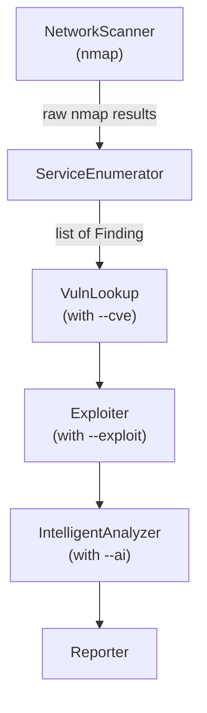

# Anansi

Anansi is a penetration testing framework: it scans a target with `nmap`, records each open service as a finding, and can look up CVEs, map findings to compliance frameworks, write reports, and run scans on a schedule from a web dashboard.

Only scan systems you own or have written permission to test.

## Using Anansi

The [README](https://github.com/herson/anansi/blob/main/README.md) covers installation, every command-line flag, configuration, and the dashboard and API.

```bash
python3 main.py --target 192.168.1.10 --cve
```

## How the scan pipeline fits together



Steps marked with a flag run only when it is given. `main.py` runs them in this order; compliance mapping and the PDF report follow the report.

Each module page shows its class and an example:

- [Scanner](modules/scanner.md)
- [Enumerator](modules/enumerator.md)
- [Reporter](modules/reporter.md)
- [Exploiter](modules/exploiter.md)

## Design decisions

The architecture decision records in [`docs/adr`](adr/0003-model-scan-results-as-typed-finding-records.md) explain why the code is shaped the way it is. Start with ADR-0003, which defines the `Finding` record every module passes along.

## Contributing

See the [contributing guide](https://github.com/herson/anansi/blob/main/.github/CONTRIBUTING.md).
